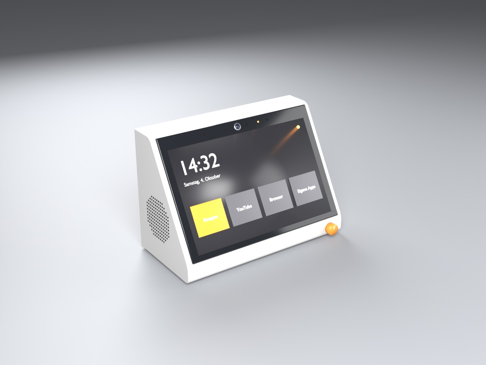
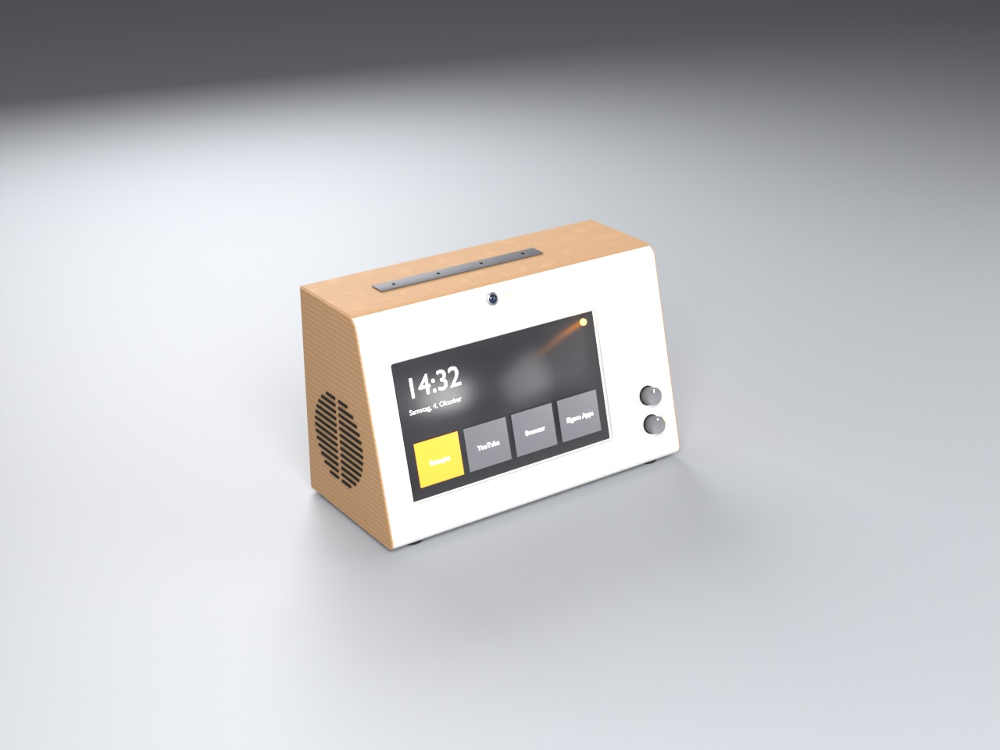
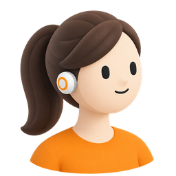
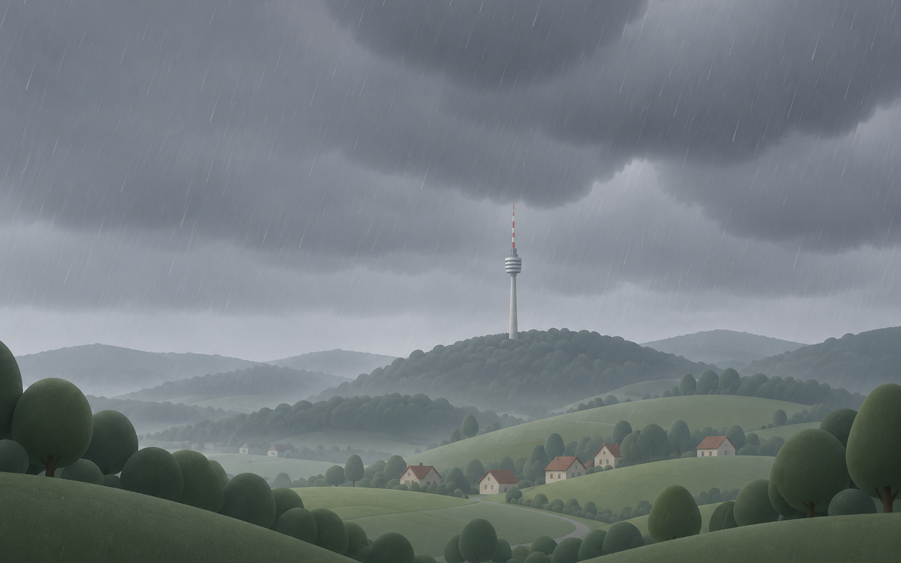

# Wie das Küchen-Display entstand

Als Website mit klickbaren Entwürfen: <https://dragondiver.github.io/kuechen-display/>

Eine kurze Entwicklungsgeschichte. Die Einzelheiten und alle Festlegungen stehen in
den Issues, vor allem in [#1](https://github.com/dragondiver/kuechen-display/issues/1)
(Übersicht), [#15](https://github.com/dragondiver/kuechen-display/issues/15)
(Ruhebildschirm) und [rundfunk#128](https://github.com/dragondiver/rundfunk/issues/128)
(Sprache).

## Anfang Oktober 2026: ein zweites Gerät neben Elektra

Elektra, das runde Sprachgerät im Wohnzimmer (Repo `rundfunk`), sollte Gesellschaft
bekommen. Zuerst war das ein Stack-chan-Roboter. Am **4. Oktober** begann daneben die
Übersicht für ein Gerät mit Touchdisplay, Raspberry Pi und Mikrofonleiste. Die
Stilrichtung stand am selben Tag fest: **Braun und Dieter Rams**.

## Das Gehäuse: von Entwurf C bis O (4.–16. Oktober)

Das Gehäuse entsteht als Blender-Skript, jeder Buchstabe ist ein Entwurf
(`gehaeuse/blender/entwurf_c.py` bis `entwurf_o.py`). Wichtige Schritte:

- **5. Oktober, Entwurf K:** weich gekantete Frontplatte nach dem Braun-Radio RT 20.
  Druckteilung für den Bambu Lab A1, der nur eine Farbe pro Teil druckt.
- **9. Oktober:** Stack-chan wird beerdigt, das Projekt heißt jetzt **Küchen-Display**.
- **13. Oktober:** Der Standort steht fest: frei auf der Halbinsel in der offenen Küche,
  der Bildschirm schaut zur Köchin, der Rücken zum Esstisch und Wohnzimmer.
- **15. Oktober, Entwurf O:** 75° Neigung, Lautsprechergitter als Langlöcher und
  Holzmantel wie beim RT 20, Kamera mittig im weißen Rahmen. Statt 10 Zoll wird es ein
  8-Zoll-Display (Waveshare 8inch DSI LCD (C)).
- **17. Oktober:** Die Hardware ist bestellt: Pi 5, Display, reSpeaker XVF3800,
  Kamera, Lautsprecher, Akku.

| Entwurf K | Entwurf O |
|---|---|
|  |  |

Mehr dazu: [Galerie](entwuerfe/galerie/index.html), [Entwurfsgeschichte](entwuerfe/geschichte/index.html),
[Hardware-Auswahl](entwuerfe/hardware-auswahl.html).

## Der Ruhebildschirm (18. Oktober)

Ein Abend Design-Gespräch, Ergebnis in [#15](https://github.com/dragondiver/kuechen-display/issues/15):

- **Inhalt:** Was heute ansteht (Familienkalender bei Apple) und das Wetter, lesbar im
  Vorbeigehen, ruhig wie Apple TV.
- **Drei Richtungen,** A Vollbild, B geteilt, C Glaskarten. Gewählt wurde **C**: zwei
  mattierte Glaskarten über einem Wetterbild.
- **Erinnerung:** 20 Minuten vor einem Termin, nur wenn jemand da ist: weißer Rand,
  weicher Ton, ein gesprochener Satz. Ein Alarm weckt zusätzlich mit einem Braun-Weckerton,
  und Elektra im Studio sagt es gleichzeitig.
- **Seiten:** Apps ← Heute → Morgen/Woche, geblättert per Wischen, Apps wie bei CarPlay.
- **Wetterbild:** illustriert statt Foto, mit dem **Stuttgarter Fernsehturm** in der Lücke
  zwischen den Karten.

Zum Ausprobieren: [Ruhebildschirm-Entwürfe](entwuerfe/ruhebildschirm.html).

## Eigenes Repo und eine Elektra (19. Oktober)

- **Eigenes Repo:** Die Karten zogen aus `rundfunk` hierher um. Von rundfunk ließe sich
  nur das Sprach-Gehirn wiederverwenden, Oberfläche, Pi und Gehäuse haben dort kein
  Gegenstück. Das Repo ist öffentlich, fremde Referenzbilder bleiben lokal.
- **Sprache ([rundfunk#128](https://github.com/dragondiver/rundfunk/issues/128)):**
  „Eine Elektra ist das Ziel“. Das Display wird ein zweites Gerät an der rundfunk-Bridge,
  mit eigenem Aktivierungswort, Oberfläche auch per Stimme bedienbar, Freisprechen auch in
  der Küche. Design und Umsetzungsplan liegen in rundfunk.
- **Kamera ([#2](https://github.com/dragondiver/kuechen-display/issues/2)):** zuerst Gesten,
  flache Hand für Stopp, Wischen zum Blättern, Rezeptschritte als Karten. Alles bleibt lokal.

## Elektras Figur und die Wetterbilder (19. Oktober)

Ob Elektra zuhört, zeigt eine Figur unten rechts. Drei abstrakte Gesichter und eine
selbst gezeichnete Figur gefielen nicht. Florians ChatGPT-Bild einer Frau mit
Pferdeschwanz wurde zur Vorlage, und `werkzeuge/figur_bilder.py` erzeugt daraus über die
OpenAI-Bild-API vier Zustände: zuhören, sprechen (halb und offen), nachdenken.

Die Wetterbilder entstehen ebenso mit `werkzeuge/wetter_bilder.py`. Der erste Lauf war
gemalt und fast fotografisch, und der Turm stand an der falschen Stelle. Er wird seitdem
per Zuschnitt in die Lücke gesetzt. Drei Stilideen für Regen passend zur Figur folgten,
gewählt wurde **flach**.

Aus der Regen-Idee entstand noch am selben Abend die ganze Serie im Stil „flach“:
gedämpft, sonnig, wolkig, Nacht, Schnee und Regen, zusammen für 16 Cent.

| Figur F2 (zuhören) | Regen, Stil „flach“ |
|---|---|
|  |  |

Wie die Bilder entstehen und was sie kosten: [bilder-erzeugen.md](bilder-erzeugen.md),
[bild-laeufe.md](bild-laeufe.md).

## Wie es weitergeht

- Wetterbilder: „gedämpft“ ohne Regenstriche neu erzeugen, dann die Serie für den Bau festlegen.
- Tischtest der Elektronik ([#18](https://github.com/dragondiver/kuechen-display/issues/18)),
  sobald die Hardware da ist.
- Die Bridge lernt das zweite Gerät (Plan in rundfunk), danach folgt das Programm auf dem Pi.
