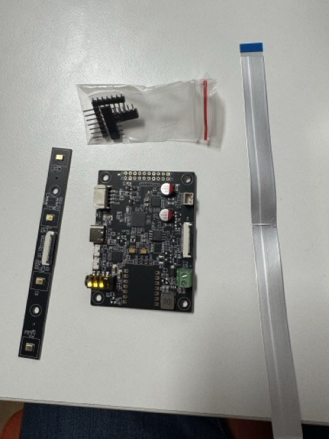
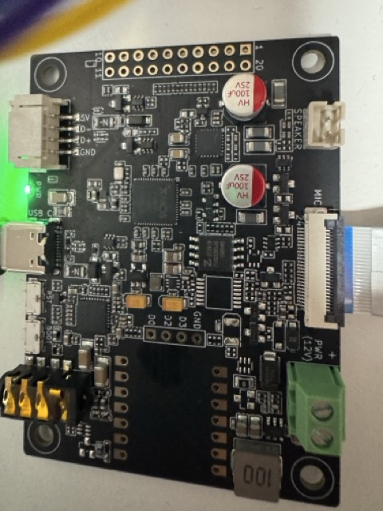
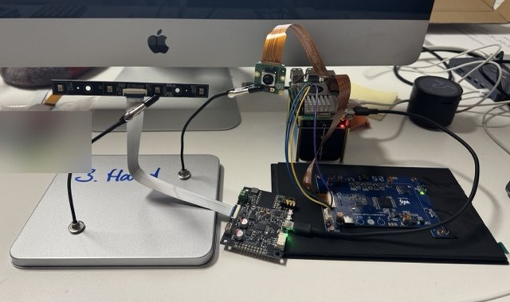
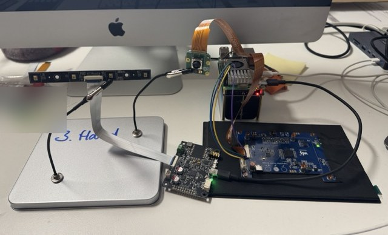
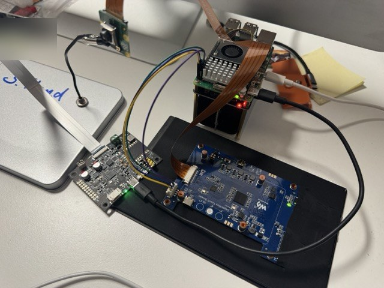
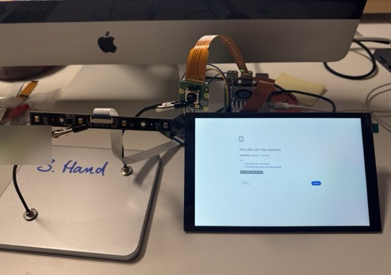
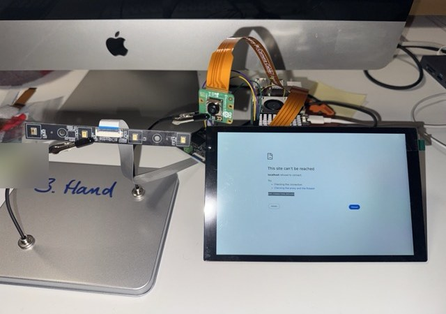

# Tischtest XVF3800

Laufende Doku zum Tischtest ([#18](https://github.com/dragondiver/kuechen-display/issues/18)),
begonnen am 7.11.2026. Der Test kommt vor dem Gehäusedruck, weil USB-Strom und
Echounterdrückung das Projekt noch kippen können.

## Teile

reSpeaker Flex XVF3800 Linear-4 ohne XIAO: Hauptboard, lose Mikrofonleiste, Flachbandkabel,
Stiftleisten.

Beschriftung am Board: USB-C, 5V/D−/D+/GND, SPEAKER (zweipolig), MIC, PWR (12V) mit Schraubklemme.

Die Buchse SPEAKER hat 2,0 mm Stiftabstand (gemessen), passt also vermutlich zu JST PH; der Typ steht
nicht in den Seeed-Unterlagen. Dupont-Stecker passen wegen ihrer Breite nicht nebeneinander hinein. Auf
der 20-poligen Lochreihe liegen laut [Seeed-Belegung](https://wiki.seeedstudio.com/respeaker_flex_introduction/)
keine Lautsprecher-Signale, wohl aber 5V_IN und GND.

## Aufbau

Mikrofonleiste am Halter, Pi-Stapel mit UPS HAT dahinter, davor das Display von hinten.

## Stromversorgung des Verstärkers

Stand der Herstellerangaben, am Board noch nicht gemessen:

- Das [Seeed-Wiki](https://wiki.seeedstudio.com/respeaker_flex_introduction/) nennt die 12-V-Klemme
  als Versorgung des ganzen Systems, mit Lautsprechern bis 10 W an 4 Ω. USB-C wird ebenfalls als
  Stromversorgung genannt. Ob der Verstärker an USB allein läuft, steht dort nicht.
- Der Verstärker ist ein TPA3139D2, laut [TI](https://www.ti.com/product/TPA3139D2) spezifiziert
  für 3,5 bis 14,4 V.

## Messwerte

### Board am Pi, ohne Lautsprecher (7.11.2026)

Das Board muss an einen USB-A-Port des Pi. An der USB-C-Buchse leuchtet zwar die LED, der Pi sieht
aber kein Gerät.

- Erkannt als `2886:0022 reSpeaker Flex XVF3800 L16K6Ch`, Firmware für die Linear-Leiste,
  USB 2.0 High Speed, angemeldeter Strombedarf 400 mA.
- Aufnahme: 6 Kanäle, 16 kHz, nur `S16_LE`. Wiedergabe: 2 Kanäle, 16 kHz.
- Strom: `throttled=0x0`, `EXT5V_V` 5,2 V, ohne `usb_max_current_enable=1`.
- Aufnahmepegel in Ruhe (RMS): Kanal 0 −52 dBFS, Kanal 1 bis 5 −72 bis −76 dBFS.

### Klopftest an der Leiste

Mit dem Fingernagel der Reihe nach an den vier Mikrofonen geklopft, 25 s Aufnahme. Spitzenwert in
dBFS der lautesten Sekunde jedes Klopfers. Von welchem Ende der Leiste aus geklopft wurde, ist nicht
festgehalten:

| Klopfer | Kanal 2 | Kanal 3 | Kanal 4 | Kanal 5 |
|---|---|---|---|---|
| 1. Mikrofon | −22 | −21 | −18 | **−12** |
| 2. Mikrofon | −18 | −21 | **−15** | −18 |
| 3. Mikrofon | −19 | **−11** | −21 | −18 |
| 4. Mikrofon | **−14** | −20 | −17 | −23 |

Jedes Mikrofon ist am lautesten auf einem eigenen Kanal, alle vier gehen also durch, trotz Knick im
Flachbandkabel. Die Kanäle 2 bis 5 liegen in der Reihenfolge der Mikrofone auf der Leiste; welcher
Kanal welches MIC-Etikett ist, ist offen. Kanal 0 und 1 reagieren ebenfalls, Kanal 0 schlug dabei bis 0 dBFS aus. Ihre Bedeutung steht nicht in
den Seeed-Unterlagen, die wir gelesen haben.
