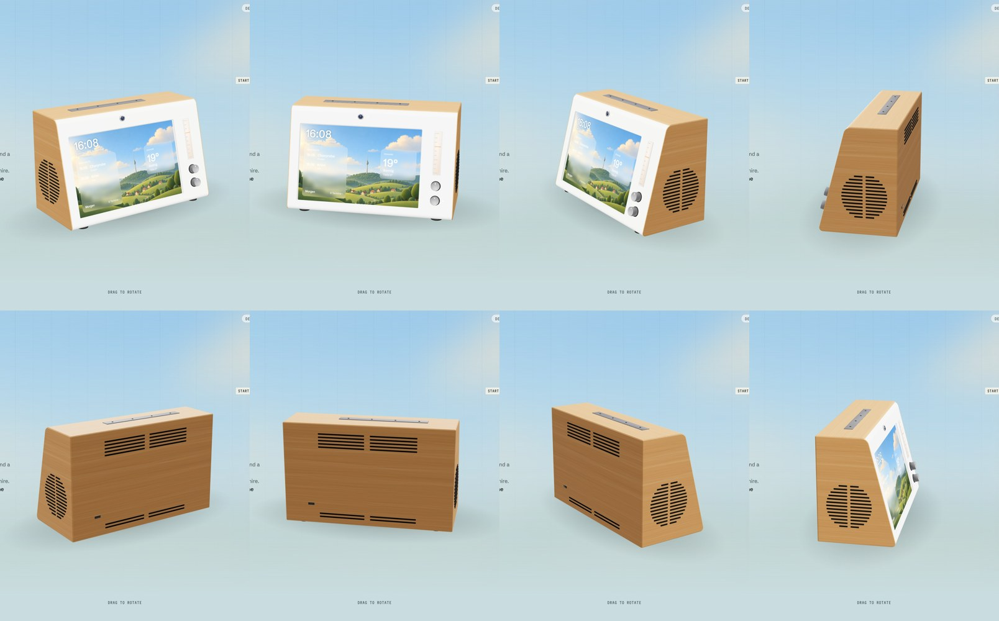

# Zielentwurf für das Gehäuse

Florian hat am 22.11.2026 festgelegt: Das Außendesign ist Entwurf O in der Variante
`w75 acht mantel skala`. Das ist das drehbare Modell der
[Projektseite](https://dragondiver.github.io/kuechen-display/projekt/) und das Bild
`docs/projekt/bilder/entwurf-fertig.jpg`. Über das Aussehen wird nicht neu verhandelt,
nur über Maße, wenn sie nicht passen.

Die Konstruktion A vom 19.11. (`gehaeuse/cad/gehaeuse.py`, PR #98) ist gestrichen.

## Wo das Ziel zu sehen ist

Maßgeblich ist das drehbare Modell auf der Projektseite:
<https://dragondiver.github.io/kuechen-display/projekt/>

Dort sieht man Holzmaserung, Bildschirminhalt und Skala so, wie das Gerät aussehen soll.
Die Screenshots in `projektseite/` halten diesen Stand vom 22.11.2026 fest, falls sich die
Seite später ändert. `projektseite/seite_uebersicht.jpg` zeigt alle acht Richtungen auf einem Blatt.



## Was hier liegt

| Datei | Inhalt |
|---|---|
| `ansichten.py` | holt das Modell aus `docs/projekt/modell.js` und rendert die Ansichten |
| `entwurf_o.glb` | das Modell der Projektseite als GLB (wird vom Skript geschrieben) |
| `ansichten/` | acht Rundumansichten, vier gerade Ansichten, zwei Übersichtsblätter |
| `projektseite.py` | nimmt Screenshots des drehbaren Modells der Projektseite auf |
| `projektseite/` | die Screenshots: acht Richtungen, ein Blick von oben, ein Übersichtsblatt |

Quelle des Modells ist `gehaeuse/blender/entwurf_o.py`; `werkzeuge/modell_exportieren.py`
macht daraus `docs/projekt/modell.js`.

## Ansichten neu erzeugen

```bash
uv run --with pyvista --with trimesh --with pillow python gehaeuse/zielentwurf/ansichten.py
```

Die Screenshots der Projektseite neu aufnehmen (braucht Google Chrome und Netz):

```bash
uv run --with playwright --with pillow python gehaeuse/zielentwurf/projektseite.py
```

Der Lauf von `ansichten.py` braucht kein Fenster und dauert unter einer Minute. Das Skript gibt außerdem die
Maße jeder Baugruppe aus. `entwurf_o.glb` und `ansichten/` stehen in `.gitignore`, weil
sie sich jederzeit neu erzeugen lassen.

## Woran der Entwurf zu erkennen ist

- Holzmantel um Oberseite, Seiten und Rücken, Kanten gerundet
- weiße Frontplatte, 75° geneigt, Ecken weich
- Display hinter dem weißen Rahmen, sichtbar ist nur die Bildfläche
- Kamera mittig über dem Bild
- Skala rechts neben dem Bild, darunter zwei Drehknöpfe
- Lautsprechergitter als Langlöcher im Kreis auf beiden Seiten
- Mikrofonleiste oben, Lüftungsschlitze oben und unten im Rücken, vier Füße

## Maße

Gemessen am Modell:

| | |
|---|---|
| Breite | 235 mm |
| Tiefe | 105 mm |
| Höhe ohne Füße | 143 mm |
| Länge der Schräge | 148 mm |
| Oberseite | 67 mm |
| Neigung der Front | 75° |
| Rückwand | lotrecht |

Florian hat am 22.11.2026 alle Angaben vom 19.11. gestrichen (Tiefe 120 mm, Höhe 152 mm,
Schräge 157 mm, Kernplatine auf den Display-Bolzen, Neubau in Code-CAD). Es gilt der Stand
davor. Ob die Einbauten in diese Maße passen, ist neu zu prüfen.

Die Rundumbilder sind in Parallelprojektion gerendert, damit senkrechte Kanten im Bild
senkrecht bleiben.
